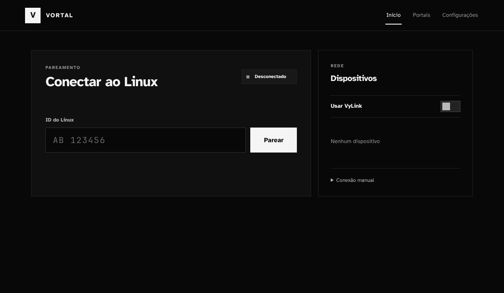
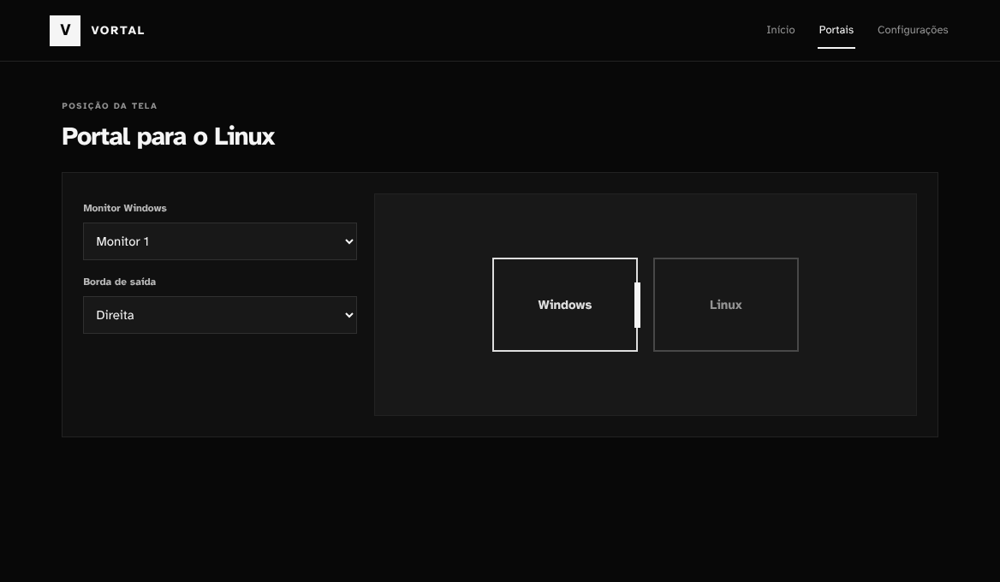
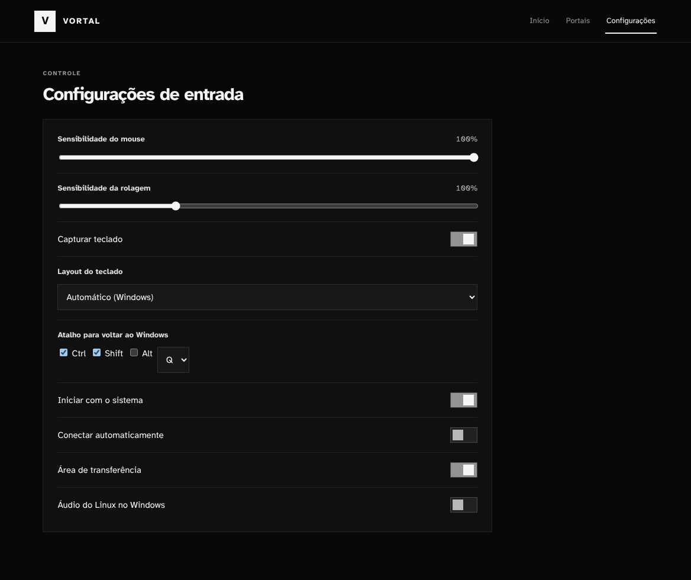

# Vortal

**Um mouse e um teclado para o Windows e o Linux.**

O Vortal liga os dois computadores pela rede. Arraste o cursor pela borda escolhida no Windows para controlar o Linux; para voltar, cruze a borda de retorno ou use o atalho configurado. A conexão é aprovada pelo ID mostrado no Linux, sem precisar copiar certificados à mão.



*Prévia da interface Windows com dados de exemplo.*

## O que ele faz

- **Portais:** escolha o monitor e a borda por onde o cursor entra no Linux.
- **Pareamento por ID:** digite o ID do Linux no Windows e aprove o pedido no outro computador.
- **Área de transferência:** compartilhe texto e copie imagens do Windows para o Linux.
- **Áudio:** ouça no Windows o som reproduzido no Linux.
- **Segundo plano:** feche a janela e continue conectado pelo ícone da bandeja. O Vortal também pode iniciar com o Windows.
- **Idioma automático:** a versão Windows usa português do Brasil quando esse é o idioma do sistema; nos demais casos, usa inglês.

### Portais

Escolha a borda do monitor Windows que leva ao Linux. A tela mostra a posição dos computadores antes de você atravessar.



### Configurações

Ajuste mouse, teclado, atalho de retorno, inicialização, área de transferência e áudio em um só lugar.



## Como começar

Você precisa de um **Windows x64** e de um **Linux com Wayland** na mesma rede. O receptor Linux foi testado no **Hyprland**. Tailscale é uma forma simples de colocar os dois computadores na mesma rede.

1. **No Linux:** instale o Vortal com `./scripts/install.sh`, abra o app e copie o ID mostrado em **Configurações**.
2. **No Windows:** instale e abra o Vortal. Digite o ID do Linux e clique em **Parear**.
3. **No Linux:** confira o pedido e clique em **Permitir**. Depois, no Windows, abra **Portais** e escolha o monitor e a borda.

O instalador Windows é gerado em `dist/windows-native/Vortal-Setup-Rust-x64.exe`. Como ele ainda não é distribuído pelo GitHub Releases, quem clonar o projeto pode gerá-lo com `scripts\build-windows.bat`. O script precisa de Rust, Visual Studio C++ Build Tools e NSIS. Para instalar no Linux, o script usa Rust e as bibliotecas GTK de desenvolvimento. Veja o [guia de instalação](installers/windows/README.md) para os requisitos completos e o pareamento manual.

## Estado do projeto

O Vortal está em desenvolvimento. O fluxo principal é **Windows → Linux/Wayland**. A integração com Hyprland é a mais testada; outros ambientes Wayland podem exigir ajustes. O pareamento por ID evita a troca manual de arquivos na configuração comum. VyLink é opcional para quem usa essa rede.

O Vortal é feito em Rust. A janela e o controle de mouse e teclado funcionam separadamente, para que uma falha da interface não prenda o controle local.

<details>
<summary>Desenvolvimento</summary>

```sh
cargo fmt --all -- --check
cargo clippy --workspace --all-targets -- -D warnings
cargo test --workspace
```

Mais detalhes em [CONTRIBUTING.md](CONTRIBUTING.md) e na [arquitetura](docs/architecture.md).

</details>

## Licença

Apache-2.0 ou MIT, à sua escolha. Consulte [LICENSE-APACHE](LICENSE-APACHE) e [LICENSE-MIT](LICENSE-MIT).
